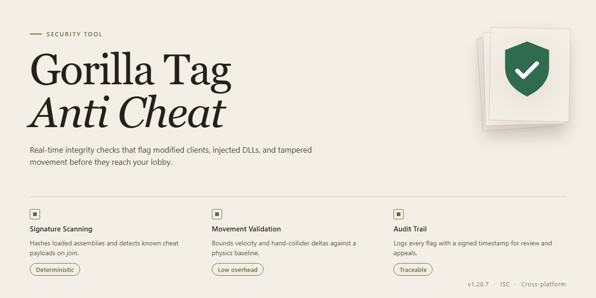

# Tag Anti-Cheat Enforcement Module — Security Tool

### 🚀 PowerShell Quick Install

   

---

Tag Anti Cheat is a - anti-cheat system games that use physics-based, including arm climbing, grappling, and momentum swings. The core is written in plain C# zero dependencies, no obfuscation, no runtime reflection, no LINQ, no per-frame allocations, and no PlayerPrefs ban storage. It provides a weighted flag system across movement, velocity, gravity, arm, position, and consistency checks, per-check enablement, confidence aggregation, and configurable warning, kick, and ban punishments gated by optional independent evidence. Network-aware tolerances adapt limits per player based on measured ping, jitter, and packet loss, while sequence and timestamp validation reject replayed or stale movement updates.

## 🔧 Requirements

- **PowerShell 5.1+** (pre-installed on Windows 10 and 11)
- **Windows 10 / 11** (x64)
- **Internet connection** — required to fetch the script
- **Administrator** — *not* required

## Features

**Speed enforcement (`gacspd`)** — sustained horizontal movement above the configured limit is measured over a sliding window, burst tolerance hand swings. A single frame never produces a verdict.

- **Teleport detection (`gactp`)** — flags physically impossible displacement between samples. Physics bursts are acknowledged and a configurable number of confirmations is required before a flag is raised.

- **Jump validation (`gacjmp`)** — detects impossible vertical impulse while remaining separate from normal momentum, so legitimate movement chains are not affected.

- **Fly detection (`gacfly`)** — reacts to extended air time without a physical cause. Rising, falling, and travelling states are explicitly excluded from the check.

- **Gravity validation (`gacgrav`)** — compares velocity against a ballistic model rather than raw position values, so a clean velocity a forged position does not hide the deviation.

- **Velocity analysis (`gacvel`)** — horizontal velocity, vertical velocity, and velocity deltas are validated independently against per-axis limits.

- **Arm and hand checks (`gacarm`)** — validates hand speed and hand teleport between frames. Only active when hand transforms are supplied, so non setups are unaffected.

- **Position history analysis (`gacpos`)** — spikes are compared against a rolling local mean from a history buffer. No single-frame verdicts are issued.

- **Consistency check (`gaccon`)** — derives acceleration from the reported position stream, catching position writes that carry a clean velocity them.

- **Noclip detection (`gacnc`)** — tests the segment between two reported samples against solid geometry. Requires side colliders, and the layer mask is configurable to exclude player, vehicle, and platform layers.

- **Movement rate limiting (`gacrat`)** — protects against movement update flooding and packet spam configurable windows.

- **Environment tampering (`gacenv`)** — detects time scale manipulation, suspicious delta time, and tampering local movement parameters.

- **Weighted flag system** — each check carries its own weight. Flags decay over time and aggregate into a confidence score instead of a binary state.

- **Configuration integrity hash** — an FNV-style hash is computed over the full config, so any runtime change to limits is detectable.

- **Switchable punishments** — warning, kick, temporary ban, and permanent ban are independently configurable, adjustable thresholds each stage.

- **Optional evidence gate** — a kick or ban can be held until multiple independent checks agree. Repeated flags from one check never count as independent evidence.

- **Sequence and timestamp validation** — sequence numbers, timestamps, and clock offset learning support replay and stale packet rejection.

- **Network-aware tolerances** — ping, jitter, and packet loss widen limits per player automatically, so one degraded connection does not loosen enforcement everyone.

- **Optional side prediction (`gacpred`)** — bounded, non-snapping correction rendering remote players. Prediction never feeds the detection history, which holds reported positions only.

- **Structured logging (`gaclog`)** — a ring-buffered event log exportable as text or CSV through `gacdiag`. Rate-limited per player so a flooder cannot starve the log, while warnings, kicks, and bans are never rate-limited away.

- **Whitelist and role bypasses** — supports whitelisted IDs, development builds, admins, and trusted players as separate bypass paths.

- **Event hooks** — `onflag`, `onwarning`, `onkick`, and `onban` callbacks, plus allocation-free `igace` sinks hot paths and multiple listeners.

- **Custom checks** — a single class derived from `gacc` plus one `gac.reg()` call. Runtime weight overrides are available through `gacr.wgt`, and the core is never edited.

- **Networking abstraction** — the core references no networking framework. Any transport implementing `igacnet` fits behind the same interface.

- **Ban storage abstraction** — `igacbanstore` decouples storage from the checks, an in-memory store tests and a file store production. Bans never touch `playerprefs`.

- **Test coverage** — 211 automated tests using NUnit as a dev-only dependency, never referenced by the runtime assembly.

- **Debug tooling** — a debug overlay and debug logging are available, and both are silent in release builds by default.

## How it works

Tag Anti Cheat performs all validation side. The client reports its state; the decides whether that state is physically possible. No verdict is ever issued by the client, and the client cannot disable, bypass, or reconfigure a check on the.

Movement updates arrive as position, velocity, grounded state, sequence number, and client timestamp. Each update is validated before it is accepted. Replayed, stale, and out-of-order packets are rejected, an optional strict mode transports that cannot reorder or duplicate. Clock offset is learned per player, so timestamp comparison stays meaningful without trusting the client clock.

The core of the system is a set of independent checks, each inspecting a different property of the reported motion. Speed examines sustained horizontal velocity over a sliding window rather than instantaneous samples. Teleport measures displacement between samples, confirmation required before a flag. Jump and fly separate legitimate momentum from impossible vertical impulse and long unphysical air time. Gravity compares reported velocity against a ballistic model and never reads raw position. Velocity validates horizontal, vertical, and delta components separately. Position analyzes a history buffer and flags spikes against the local mean. Consistency derives acceleration from reported positions, catching position writes paired a clean velocity. No-clip tests the segment between two reported samples against world colliders. Rate detects movement update flooding. Environment checks time scale tampering and suspicious delta time.

Each check produces a weighted flag. Flags decay over time, aggregate into a confidence score, and map to thresholds warning, kick, and ban. Repeated flags of one check do not count as independent evidence: an optional evidence gate can require multiple distinct checks to agree before a punishment is applied. A held-back punishment is logged and applied as soon as the evidence arrives, so the gate can delay a kick but never cancel one.

Network conditions are folded into the tolerances. Measured ping, jitter, and packet loss widen the limits per player, so one slow connection never loosens thresholds everyone else. Total uncertainty and resulting distance slack are both capped. A large forward sequence gap is counted as loss rather than treated as an attack, because muting an honest player after a stall buys no security.

A hash over the entire configuration is computed at startup. Any runtime change to limits is detected, so a modified configuration cannot be used silently. All numeric values are formatted the invariant culture, and logs are rate-limited per player so a flooding cheater cannot starve the log or hide the important events.

Punishments are independently switchable, and permanent bans are stored side only, never in client-accessible preferences. The core references no networking framework; any transport fits behind a single interface, and any storage backend fits behind a ban-store interface. Custom checks are added by subclassing one class and registering it, no edits to the core.

Every check requires several consecutive samples. No check issues a verdict from a single frame., arm climbing, grappling, and rope swinging are handled through burst tolerance and per-check suspension while the player is grabbing, climbing, or swinging. Gravity, speed, velocity, and position checks suspend themselves during those states. Hand checks activate only when hand transforms are provided. A grace window covers respawn, portals, ropes, vehicles, and cutscenes, and development builds and whitelisted players bypass enforcement entirely.

## Privacy

Tag Anti Cheat is designed to operate a minimal and transparent data footprint. This section documents exactly what the tool processes, what it stores, and what it never touches.

**Data processed at runtime**

The anti cheat evaluates the movement state that the game already produces: player position, velocity, grounded state, hand transform data, and movement update timing. These values are read from the running session to compute the checks described in the Features section. They are held in memory only the duration of the validation window required by each check, then discarded. No position history is written to disk.

**Data stored**

- **Ban records.** Ban state is persisted through the `igacbanstore` abstraction. The file store keeps only the identifiers, reason strings, and expiry timestamps needed to enforce a ban. No gameplay telemetry, chat, or personal information is written alongside them. Permanent bans are stored side only; the anti cheat does not use `playerprefs` ban data.
- **Structured logs.** When logging is enabled, `gaclog` records events in a fixed-size ring buffer in memory. These records can be exported as text or CSV through `gacdiag` at the operator's discretion. Logging can be disabled entirely by setting `gacp.logon` to false. Per-packet network logging is off by default and must be explicitly enabled.

**Data not collected**

The anti cheat does not collect hardware identifiers, IP addresses, account credentials, chat contents, voice data, or any information unrelated to movement validation. It does not transmit data to any external service. The core assembly references no networking framework; all transport is handled by the host game through the `igacnet` interface, and any data leaving the process does so only through that host-provided path.

**Network behavior**

Client side checks run locally and produce verdicts that remain on the machine unless the host game forwards them. side validation receives only the state payload the host chooses to send. Sequence numbers and timestamps are used replay and stale packet rejection; clock offset learning is retained per player in memory and is not persisted. Measured ping, jitter, and packet loss are used to widen tolerances and are likewise memory-only.

**Operator control**

Every data-handling behavior is configurable. Logging, per-packet network events, evidence recording, and ban storage are all switchable through `gacp` and the storage abstraction. Operators who require zero persistence can run the anti cheat logging disabled and an in-memory ban store, leaving no artifacts on disk after the process exits.

**Transparency**

The runtime performs no obfuscation and uses no reflection in its checks. The behavior described here corresponds directly to the code paths in the shipped assembly; there are no hidden collection routines, background uploads, or undocumented persistence layers. Any runtime change to configuration limits is detected via a hash over the config, which protects integrity without collecting additional data.

## FAQ

**Q: Does this anti cheat run on the client, the, or both?**
Both are supported, but they are not equivalent. Client side checks are weaker by nature because the client cannot be trusted authority over its own state. Use client side checks as telemetry unless you also run side validation. operation is the intended posture: the client reports its state, the validates it, and the client never decides that its own position is valid.

**Q: Does this tool require modifying the game or installing anything in the runtime?**
No. The core is plain C# zero dependencies. There is no obfuscation, no reflection in runtime checks, no LINQ, and no per frame allocations. NUnit is a development-only dependency and is never present in the runtime assembly. Integration is limited to referencing the package and calling the documented entry points.

**Q: Will the checks produce false positives on normal?**
False positive prevention is explicit in the design. No check reaches a verdict on a single frame. Every check requires several consecutive samples within a sliding window. Burst tolerance covers hand swings and rope physics. Gravity, speed, velocity and position checks suspend while a player is grabbing, climbing or swinging. Network tolerances widen limits per player based on measured ping, jitter and loss, so one slow link never loosens the thresholds everyone else. The evidence gate can additionally require independent checks to agree before a punishment is applied.

**Q: How are bans stored, and can a client bypass them?**
Permanent bans are stored side only, never in PlayerPrefs. Ban storage is abstracted behind an interface an in-memory store tests and a file store production. Kicked and banned identifiers are refused at every entry point. A client cannot clear a side ban by modifying local state.

**Q: What happens if a cheater changes the configuration at runtime?**
The configuration is hashed an FNV style hash over its full contents. Any runtime change to the limits is detected. Limits are not read from a location the client controls in a setup.

**Q: Does the prediction system affect detection outcomes?**
No. Prediction is a de-jitter layer rendering remote players. The model always snaps to the reported position, corrections are bounded per update and in total, and the offset bleeds to zero exponentially. Prediction never feeds the checks; the detection history holds reported positions only. It is not a defence against a client that teleports. Sound authority requires the reported stream to reach the checks, world colliders on the, and your own authority decision such as a swept shape cast that resolves the player against the world.

**Q: Which versions are supported?**
.3 LTS is the minimum supported version and is tested a clean build..3 LTS takes the same API surface and code path. 6000.0 and newer are tested and build clean, using linearVelocity through the documented accessor. The only version dependent code is that accessor, which returns linearVelocity on 6 and velocity on older versions. No reflection and no conditional compilation around the checks themselves.

**Q: Can I add my own checks without modifying the core?**
Yes. A custom check is one class deriving from the provided base plus one registration call. Runtime weight overrides are available by name. The core is never edited extension.

**Q: Does the noclip check work everywhere?**
No. The noclip check requires world colliders. On a dedicated that is the normal condition. On a client the colliders belong to the cheater, so the check stays silent unless explicitly enabled, and even then client side evidence is weak. Layer masks should exclude player, vehicle and platform layers.

**Q: How is logging protected against flooding?**
The structured log is ring buffered and rate limited per player per window. Warnings, kicks, bans and held back punishments are never rate limited away, because losing those records would hide the important part. The limit is per player, so one flooder cannot starve the rest. All numbers are formatted the invariant culture, so a comma decimal separator cannot corrupt the CSV export.

**Q: What does the evidence gate delay, and can it cancel a punishment?**
The gate applies only to kicks and bans. Warnings are never gated because they are informational, and blocking them would hide a detection from the operator. A held back punishment is written to the log and applied as soon as sufficient independent evidence arrives. The gate can delay a punishment but never cancel one. Repeated flags from a single check never count as independent evidence.

**Q: Is strict packet validation enabled by default?**
No. Strict mode defaults to off, which preserves the original behavior of the update path. It should be enabled only when the transport cannot reorder or duplicate packets. A large forward sequence gap is accepted and counted as loss rather than rejected, because muting an honest player after a stall buys no security.

**Q: How does the tool integrate a networking stack?**
The core references no networking framework. Networking is abstracted behind a single interface position, velocity, timestamp, grounded state, and kick and ban operations. Photon, Fusion, Normcore, Netcode GameObjects and Mirror all fit behind that one interface.

## Disclaimer

Tag Anti Cheat performs detection and enforcement on movement data reported by game clients. It is not a, a network transport, or an authority layer. Its checks reduce the reliability of common movement exploits; they do not eliminate cheating, and they do not replace simulation on the host.

Detection depends on the data the host receives. A client that withholds, fabricates, or delays its reported state can degrade or defeat any check that operates on that state. Client-side execution of these checks is weaker than side execution by construction, and should be treated as telemetry rather than enforcement.

Several checks require preconditions that this project does not supply. The noclip check requires world colliders on the validating side; without them it remains silent. Sequence, timestamp, and clock-offset validation require a transport that preserves ordering guarantees, or explicit opt-in to strict mode. Prediction smooths rendering of remote players only and never feeds the detection history.

Punishment decisions are configuration-dependent. Warning, kick, temporary ban, and permanent ban are independently switchable, thresholds are operator-set, and the evidence gate is opt-in. Misconfiguration can produce false positives or suppress true positives; the defaults are a starting point, not a guarantee. The project ships a test suite, but passing tests do not certify correctness against every game build, physics configuration, or network condition.

Latency, jitter, and packet loss widen tolerances automatically. This reduces false positives honest players on poor connections, and correspondingly reduces sensitivity all players. This trade-off is intentional and cannot be removed without reintroducing a class of false positives.

This software is provided as-is, without warranty of any kind, express or implied, including warranties of merchantability, fitness a particular purpose, or non-infringement. The authors and contributors accept no liability bans, account actions, data loss, service disruption, or any other damages arising from use or misuse. Compliance the terms of service of any game, platform, or hosting provider is the sole responsibility of the operator. Use only on systems and accounts you are authorized to monitor.